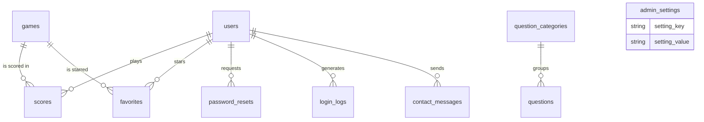

# Gridline Arcade

**Advanced Web Development – Project Part 3**
A PHP + MySQL arcade website with three browser games, user accounts, an admin dashboard, session control and cookies.

> Part 2 (the standalone HTML/Python demo) is kept in the [`part2/`](part2/README.md) folder. This README describes the Part 3 PHP/MySQL application in the repository root.

---

## 1. How the application was developed

1. **Part 2 – design and front end.** The Gridline Arcade look (dark theme, sidebar navigation, game cards) and the three games (Tic-Tac-Toe, Slide Puzzle, Quiz Challenge) were built with HTML, CSS and JavaScript, with a small Python server for the demo.
2. **Part 3 – back end.** The pages were converted to PHP and connected to MySQL through PDO prepared statements. A shared `config.php` holds the database connection, session/cookie setup and helper functions; `layout.php` holds the page header, sidebar and footer so every page looks the same.
3. **Database design.** The original 4 tables were extended to 10. Every table has the three required audit columns (`id`, `created_at`, `created_by`) and tables are linked with foreign keys.
4. **Every table is used by a web page** (see the table in section 3), so nothing is stored that cannot be seen or managed from the GUI.
5. **Security basics.** Passwords are hashed with `password_hash()` (bcrypt), all SQL uses prepared statements, output is escaped with `htmlspecialchars()`, every form carries a CSRF token, and login attempts are rate-limited.

### How the Part 3 requirements are met

| Requirement | Where |
|---|---|
| MySQL database with correct data types | [`gridline_arcade.sql`](gridline_arcade.sql) |
| 10 tables, including `users` and `admin_settings` | Section 2 |
| `id`, record date/time (`created_at`), `created_by` on every record | Every table in the SQL file |
| Every table linked to the GUI | Section 3 |
| Session control | `config.php` – strict session mode, `HttpOnly` + `SameSite` session cookie, `session_regenerate_id()` on login/logout, idle timeout (setting `session_timeout_minutes`), role/status re-checked from the database on every request, login lockout after repeated failures |
| Cookies | `GRIDLINE_SID` (session cookie), `remember_email` (login form option, 30 days), `last_game` (home page "Continue" shortcut, 30 days) |

---

## 2. Database structure

Database name: **`gridline_arcade`** (MySQL / MariaDB, InnoDB, `utf8mb4`).

Audit columns on **every** table: `id` INT AUTO_INCREMENT PRIMARY KEY · `created_at` TIMESTAMP (default `CURRENT_TIMESTAMP`) · `created_by` VARCHAR(50) (username of the creator, `guest` for visitors, `system` for seed data).

| # | Table | Purpose | Main columns (besides the audit columns) |
|---|---|---|---|
| 1 | `users` | Player and admin accounts (common table) | `username` VARCHAR(50) UNIQUE, `email` VARCHAR(190) UNIQUE, `password_hash` VARCHAR(255), `role` ENUM(user, admin), `status` ENUM(active, suspended), `bio` VARCHAR(500), `last_login_at` DATETIME |
| 2 | `admin_settings` | Site-wide settings edited by the admin (common table) | `setting_key` VARCHAR(60) UNIQUE, `setting_value` VARCHAR(255), `description` VARCHAR(255), `updated_at` TIMESTAMP |
| 3 | `games` | Game catalogue shown on Home and Game library | `slug` VARCHAR(20) UNIQUE, `title`, `category`, `symbol`, `theme`, `page_url`, `description`, `is_active` TINYINT(1), `sort_order` INT |
| 4 | `scores` | One row per finished game | `user_id` → users, `game_id` → games, `score` INT |
| 5 | `question_categories` | Quiz topics | `name` VARCHAR(60) UNIQUE, `description` |
| 6 | `questions` | Quiz question bank | `category_id` → question_categories (nullable), `question` VARCHAR(500), `option_a`–`option_d` VARCHAR(255), `correct_index` TINYINT |
| 7 | `password_resets` | Password-reset tokens (stored as SHA-256 hash) | `user_id` → users, `token_hash` CHAR(64) UNIQUE, `expires_at` DATETIME |
| 8 | `contact_messages` | Messages from the About & contact form | `user_id` → users (nullable), `name`, `email`, `message` TEXT, `status` ENUM(new, read) |
| 9 | `login_logs` | Audit trail of sessions and security events | `user_id` → users (nullable), `email_attempted`, `event` ENUM(register, login_success, login_failed, logout, session_timeout), `ip_address`, `user_agent` |
| 10 | `favorites` | Games a player has starred | `user_id` → users, `game_id` → games, UNIQUE(user_id, game_id) |

### Relationships

Deleting a user removes their scores, favourites and reset tokens (`ON DELETE CASCADE`); their log and contact rows are kept (`ON DELETE SET NULL`). Deleting a category keeps its questions without a category.

---

## 3. Structure of the web pages

All pages share `layout.php` (header, sidebar, flash messages, footer) and `style.css`.

| Page | Access | What it does | Tables used |
|---|---|---|---|
| `index.php` | Public | Home page, welcome banner, game cards, "Continue playing" cookie shortcut | `games`, `admin_settings` |
| `games.php` | Public (favourites need login) | Game library with ★ favourite button | `games`, `favorites` |
| `favorite.php` | Login | Adds/removes a favourite, then returns to the library | `favorites`, `games` |
| `tictactoe.php`, `puzzle.php` | Public (scores saved when logged in) | Browser games (logic in `games.js`) | – (scores saved through `save-score.php`) |
| `quiz.php` | Public | Quiz round, optional category filter, round size from settings | `questions`, `question_categories`, `admin_settings` |
| `save-score.php` | Login (AJAX/JSON) | Validates and stores a finished game's score | `scores`, `games` |
| `leaderboard.php` | Public | Top players, optionally filtered per game | `scores`, `users`, `games`, `admin_settings` |
| `history.php` | Login | The player's last 50 games | `scores`, `games` |
| `register.php` | Public | Create an account (can be closed by the admin) | `users`, `login_logs`, `admin_settings` |
| `login.php` | Public | Log in, "remember my email" cookie, lockout after repeated failures | `users`, `login_logs`, `admin_settings` |
| `logout.php` | Login (POST) | Ends the session and logs the event | `login_logs` |
| `forgot-password.php`, `reset-password.php` | Public | Password reset (demo shows the link on screen instead of e-mailing it) | `password_resets`, `users` |
| `profile.php` | Login | Stats, favourite games, session info and recent login activity | `users`, `scores`, `favorites`, `login_logs`, `admin_settings` |
| `edit-profile.php` | Login | Change username and bio | `users` |
| `about.php` | Public | Project info and contact form (messages are stored) | `contact_messages` |
| `admin.php` | Admin only | Tabs: Overview, Settings, Games, Categories, Questions, Users, Messages, Login logs | all 10 tables |

Supporting files: `config.php` (connection, sessions, cookies, helpers), `layout.php` (shared template), `games.js` (game logic), `navigation.js` (sidebar menu), `style.css` (styling), `gridline_arcade.sql` (schema + sample data).

---

## 4. Tools and languages

| Area | Technology |
|---|---|
| Server-side language | PHP 8 (PDO, sessions, cookies) |
| Database | MySQL / MariaDB (phpMyAdmin for import and management) |
| Front end | HTML5, CSS3, JavaScript (vanilla) |
| Local server | XAMPP (Apache + MySQL) |
| Editor / version control | Visual Studio Code, Git and GitHub |
| Part 2 demo only | Python 3 (`part2/server.py`) |

---

## 5. Required tools and setup / deployment

### Requirements
- XAMPP (or any Apache + PHP 7.4+ + MySQL 5.7+/MariaDB stack). PHP 8 recommended.
- A modern web browser.

### Steps (XAMPP on Windows)
1. Start **Apache** and **MySQL** in the XAMPP Control Panel.
2. Copy the repository files (all the `.php` files, `games.js`, `navigation.js`, `style.css`) into `C:/xampp/htdocs/gridline-arcade/`.
3. Open **http://localhost/phpmyadmin/**, click **Import** at the server level, choose `gridline_arcade.sql` and press **Go**. This creates the `gridline_arcade` database, the 10 tables and the sample data. It is safe to import again.
4. Check the database settings at the top of `config.php` (defaults: host `localhost`, user `root`, empty password, database `gridline_arcade`).
5. Open **http://localhost/gridline-arcade/index.php**. Do not open the PHP files by double-clicking them.

### Demo accounts

| Role | Email | Password |
|---|---|---|
| Player | `player@gridline.test` | `GridlineDemo!2026` |
| Admin | `admin@gridline.test` | `GridlineAdmin!2026` |

Change these passwords (or delete the accounts) before putting the site on a public server.

### Deploying to a web host
1. Upload the files to the host and import `gridline_arcade.sql` into a MySQL database there.
2. Update `DB_HOST`, `DB_NAME`, `DB_USER` and `DB_PASS` in `config.php`.
3. Serve the site over **HTTPS** – the session and remember-me cookies automatically get the `Secure` flag when HTTPS is used.
4. Replace the on-screen password-reset link in `forgot-password.php` with an e-mail, and change the demo passwords.

### Known limitations
- Scores are submitted by the browser, so a determined user could fake them; a production site would validate gameplay on the server.
- Password reset shows the link on the page for classroom testing instead of sending e-mail.
